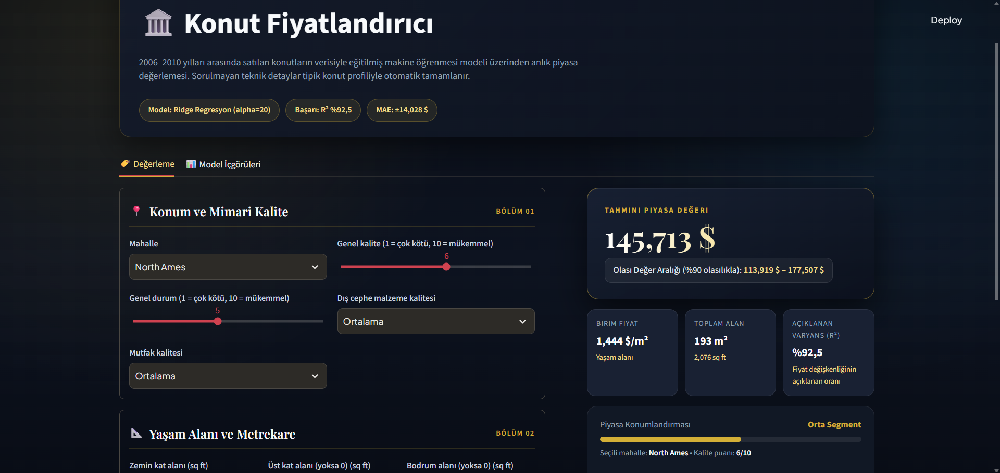

# Konut Fiyatlandırıcı

Bir evin özelliklerinden (yaşam alanı, genel kalite, mahalle, yapım yılı, garaj, bodrum vb.) satış fiyatını tahmin eden bir makine öğrenmesi projesi. Bilgisayar Mühendisliği Tasarımı dersi kapsamında, 9 haftalık bir takım projesi olarak geliştirildi.

Nihai model, bir evin satış fiyatını test kümesinde ortalama **14.028 $** hatayla tahmin ediyor. Bu, ortalama ev fiyatının yaklaşık %8'i.

## Veri

[Ames Housing](https://www.kaggle.com/c/house-prices-advanced-regression-techniques) veri seti: Ames (Iowa, ABD) şehrinde 2006–2010 yılları arasında satılan 1.460 konut ve her konut için 79 özellik. Tahmin edilen değişken satış fiyatı (`SalePrice`). Özelliklerin açıklamaları `veri/data_description.txt` dosyasındadır.

## Yöntem

1. **Temizlik:** Yaşam alanı 4.000 kare fitten büyük olan 4 aykırı ev çıkarıldı (1.456 ev kaldı). Veri setinde "NA" değeri çoğu sütunda eksik veri değil "bu özellik yok" anlamına geldiği için (havuz yok, garaj yok gibi) bu değerler "None" ya da 0 olarak dolduruldu. Gerçekten eksik olan sokak cephesi uzunluğu (`LotFrontage`) evin bulunduğu mahallenin ortanca değeriyle dolduruldu.
2. **Yeni özellikler:** Toplam alan (`TotalSF`), evin satıldığı andaki yaşı (`HouseAge`), son yenilemeden bu yana geçen süre (`RemodAge`) ve toplam banyo sayısı (`TotalBath`) türetildi.
3. **Dönüşüm:** Sıralı kalite sütunları (Mükemmel > İyi > Ortalama ...) sayıya çevrildi, diğer kategorik sütunlar her kategori için ayrı bir 0/1 sütununa açıldı, sayısal sütunlar ölçeklendi. Sonuçta model 252 sütunluk bir girdiyle çalışıyor.
4. **Hedef dönüşümü:** Satış fiyatı sağa çarpık dağıldığı için model fiyatın logaritmasını öğreniyor; tahmin sonradan dolara geri çevriliyor.
5. **Veri sızıntısını önleme:** Bütün bu adımlar tek bir işlem hattının (`kaynak/konut_model.py`) içinde yapılıyor. Böylece doldurma ve ölçekleme değerleri yalnızca eğitim verisinden öğreniliyor; test verisi eğitime karışmıyor.

## Sonuçlar

Veri %80 eğitim (1.164 ev), %20 test (292 ev) olarak ayrıldı. Modeller eğitim kümesinde 5 katlı çapraz doğrulamayla karşılaştırıldı; nihai model, çapraz doğrulama hatası en düşük olan model olarak seçildi.

| Model | Çapraz doğrulama hatası (log ölçeğinde) | Test ortalama mutlak hata | Test belirleme katsayısı (R kare) | Eğitim süresi |
|---|---|---|---|---|
| **Ridge regresyonu (alpha = 20)** | **0,1124** | **14.028 $** | **0,925** | **0,06 sn** |
| Gradient Boosting | 0,1203 | 13.947 $ | 0,920 | 1,91 sn |
| Doğrusal regresyon | 0,1298 | 14.931 $ | 0,916 | 0,08 sn |
| Random Forest | 0,1326 | 16.285 $ | 0,889 | 1,36 sn |

- Belirleme katsayısı (R kare), fiyatlardaki değişkenliğin ne kadarını modelin açıkladığını gösterir; 1'e ne kadar yakınsa o kadar iyidir.
- Ridge regresyonu hem en düşük çapraz doğrulama hatasına hem de en kısa eğitim süresine sahip olduğu için seçildi. Gradient Boosting'in test hatası biraz daha düşük, ama seçim test kümesine bakılarak yapılmadı.
- Test tahminlerinin %71'i gerçek fiyata %10'dan daha yakın. Model en çok 300.000 $ üzerindeki evlerde yanılıyor ve bu evlerin fiyatını olduğundan düşük tahmin etme eğiliminde.
- Fiyatı en çok yükselten özellikler genel kalite, yaşam alanı ve Crawford, Stone Brook gibi bazı mahalleler; en çok düşürenler ise ticari imarlı bölgede olmak ve evin yaşı.

Kaydedilen model (`modeller/nihai_model.pkl`), seçimden sonra 1.456 evin tamamıyla yeniden eğitildi.

## Haftalık ilerleme

| Hafta | Çalışma | Dosya |
|---|---|---|
| 1–2 | Proje planı ve gereksinim analizi | — |
| 3 | Veri temizliği ve keşifsel veri analizi | `defterler/hafta3_ilk_inceleme.ipynb`, `defterler/hafta3_kesifsel_analiz.ipynb` |
| 4 | Özellik mühendisliği, eğitim/test ayrımı | `defterler/hafta4_ozellik_muhendisligi.ipynb` |
| 5 | Model eğitimi (Ridge, Random Forest, Gradient Boosting) | `defterler/hafta5_model_egitimi.ipynb` |
| 6 | Çapraz doğrulama ve hiperparametre optimizasyonu | `defterler/hafta6_optimizasyon_cv.ipynb` |
| 7 | Nihai model seçimi, hata analizi, modelin kaydedilmesi | `defterler/hafta7_nihai_model.ipynb` |
| 8 | Streamlit web arayüzü | `arayuz/app.py` |
| 9 | Modelin bir API (uygulama programlama arayüzü) olarak sunulması | planlanıyor |

## Dizin yapısı

```
├── README.md
├── requirements.txt          kütüphane sürümleri
├── veri/                     train.csv ve data_description.txt
├── defterler/                haftalara göre Jupyter defterleri
├── kaynak/
│   └── konut_model.py        ortak veri temizliği ve işlem hattı
├── modeller/
│   └── nihai_model.pkl       kaydedilmiş nihai model
├── arayuz/                   Streamlit arayüzü ve ekran görüntüsü
└── gorseller/                defterlerin ürettiği grafikler (hafta3/ … hafta7/)
```

## Kurulum

Python 3.12 veya 3.13 gerekir. Model dosyası `requirements.txt` içindeki sürümlerle kaydedildiği için sürümlerin değiştirilmemesi gerekir; farklı bir scikit-learn sürümü model dosyasını açamayabilir.

```
git clone https://github.com/konut-satis-fiyati-tahmini/konut-satis-fiyat-tahmini.git
cd konut-satis-fiyat-tahmini
pip install -r requirements.txt
```

## Çalıştırma

### Jupyter Notebook

```
jupyter notebook
```

Açılan sayfada `defterler/` klasörüne girip defteri açın. Defterler veriyi `../veri/train.csv` yolundan okur ve grafikleri `../gorseller/` klasörüne kaydeder.

### Google Colab

Colab defteri tek başına açtığı için önce deponun indirilmesi gerekir. Defterin en başında şu hücreyi çalıştırın:

```
!git clone https://github.com/konut-satis-fiyati-tahmini/konut-satis-fiyat-tahmini.git
%cd konut-satis-fiyat-tahmini/defterler
```

### Web arayüzü

Deponun kök klasöründe:

```
python arayuz/arayuz_varsayilanlar_olustur.py   # yalnızca ilk seferde
streamlit run arayuz/app.py
```

Tarayıcıda açılan sayfada evin özellikleri girilir; arayüz tahmini fiyatı, %90 olasılıkla gerçek fiyatın düşeceği aralığı ve modelin nasıl seçildiğini gösteren grafikleri gösterir.



## Ekip

- Kübra Tüten
- Onur Fidan
- Rua Melhem
